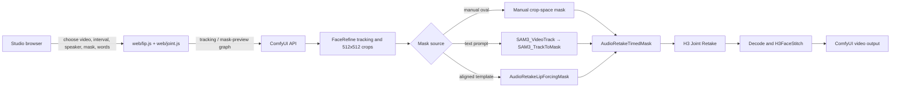

# Studio implementation and test record

This document records the custom changes in this repository, why they exist, the failure cases the code guards against, and what was actually run for the Hemsworth clip. It describes the checked-in code at commit `51282a9` (`Add LipForcing aligned mouth mask mode`). It distinguishes implemented behavior from assumptions and from visual or audio quality judgments.

## 1. Architecture in one page

This is a ComfyUI custom node package with a browser interface served by ComfyUI. It is not a second inference server and it is not one fixed, monolithic graph. The browser collects the user's media, passage, speaker point, mask choice, prompt and settings; then it creates and submits API-format ComfyUI graphs. ComfyUI's installed nodes do the tracking, H3 generation, mask application, decoding, stitching and file saving.



The app's Python entry point, [`__init__.py`](../__init__.py), registers routes and custom nodes. [`web/index.html`](../web/index.html) and [`web/style.css`](../web/style.css) define the interface; [`web/app.js`](../web/app.js) handles source/audio state; [`web/lip.js`](../web/lip.js) handles face selection, tracking, mask previews and lip repair; [`web/joint.js`](../web/joint.js) assembles and submits the Joint Retake graph. The API graphs in [`web/h3_audio_preset.json`](../web/h3_audio_preset.json) and [`web/lip_preset.json`](../web/lip_preset.json) are templates; the browser fills in the actual input paths, selected interval, prompt, mask and model settings.

Because the user reviews results between jobs, source loading happens in the browser, while face tracking, mask preview and H3 rendering are separate ComfyUI jobs. Full-video export is a later Studio API operation. The user can change the selected interval, face, prompt, mask and reference between those steps.

## 2. What changed in this fork

The commit history separates the work into the following changes:

| Commit | Change | Reason |
| --- | --- | --- |
| `c687f54` | Allow configured exact HTTPS origins for the Studio through a loopback reverse tunnel. | A Quick Tunnel URL is HTTPS at the browser but terminates at the ComfyUI process on loopback. The original localhost-only Studio routes did not accept that browser origin. |
| `25b6d86` | Read exact tunnel origins from a live allowlist file. | A Cloudflare Quick Tunnel hostname is only known after `cloudflared` starts, which can be after ComfyUI. The file lets the notebook write the exact hostname without restarting ComfyUI. |
| `d1eadf6` | Add prompt-based SAM3 masks to H3 retakes using ComfyUI's built-in nodes. | Let a user describe the lower-face region and review a generated mask rather than draw every mask manually or install a separate SAM3 node pack. |
| `a65d187` | Add optional SAM3 mask expansion. | Give the user a controlled way to enlarge the segmentation when the mask is too tight. Zero pixels is the default so the Studio does not silently enlarge it. |
| `51282a9` | Add a LipForcing-aligned mouth-mask mode, readiness reporting and a ComfyUI mask node. | Reuse the LipForcing notebook's face-alignment and fixed LatentSync mask preprocessing for H3's tracked crops, without running LipForcing's separate video generator. |

The fork keeps the three mask modes side by side. Adding SAM3 and LipForcing did not remove or reinterpret the manual oval path. The same Joint Retake H3 graph consumes each mode's mask after it is converted into the Studio crop space and H3's mask convention.

### Files changed for the mask work

| File | Responsibility added or updated |
| --- | --- |
| [`__init__.py`](../__init__.py) | Resolve the LipForcing checkout and mask path; expose readiness; register `AudioRetakeLipForcingMask`; perform per-frame alignment, inverse warp, polarity conversion and validation. It also owns the exact-origin and live-allowlist checks. |
| [`web/index.html`](../web/index.html) | Expose the mask-source selector, SAM3 prompt/expansion controls, LipForcing preview controls and status text. |
| [`web/lip.js`](../web/lip.js) | Create and review tracking/mask previews; configure SAM3 every-frame tracking and optional `GrowMask`; fingerprint settings; ensure the selected mask mode feeds the actual lip-repair graph. |
| [`web/joint.js`](../web/joint.js) | Insert the selected SAM3 or LipForcing node into Joint Retake; connect its output to both the timed H3 noise mask and the stitch mask. |
| [`web/turns.js`](../web/turns.js) | Save/restore the per-turn mask mode and preview metadata so multi-turn UI state does not silently revert to another mask path. |
| [`web/style.css`](../web/style.css) | Layout/styling for the additional mask controls and preview. |
| `README.md`, `AGENTS.md` | Document install/runtime requirements, operator workflow, limitations and code ownership. |

The SAM3 controls are assembled into the API graph in `web/lip.js`; they are not baked into `lip_preset.json`. LipForcing is a custom Studio node because its mask-generation path needs Python/OpenCV/InsightFace and must also be callable by ComfyUI during the final render.

### Tunnel access

The route guard accepts localhost by default. For a tunnel, it normalizes the configured HTTPS origin and requires an exact host match; it rejects wildcard hosts, paths, credentials, queries and fragments. Requests must still arrive at ComfyUI from a loopback client. For writes, the browser `Origin` must exactly match the configured origin. The live allowlist file is read on each request so a notebook can atomically replace it after discovering a new Quick Tunnel hostname.

This is an origin check, not authentication. It does not add a login or protect the ComfyUI API from a person who can reach the tunnel. The single tunnel serves both `/audio-retake/` and the ComfyUI API on the same origin.

### SAM3 mode

SAM3 is run on the Studio's FaceRefine-tracked 512 × 512 face crops, not directly on an untracked full-frame video. The graph adds ComfyUI's `CheckpointLoaderSimple`, `CLIPTextEncode`, `SAM3_VideoTrack` and `SAM3_TrackToMask` nodes. The prompt, installed checkpoint and selected face-track key are part of the preview fingerprint. The tracking node is configured with one object and `detect_interval: 1`, so the text segmentation is evaluated on every input frame; it is not a five-frame interval approximation.

If expansion is greater than zero, `GrowMask` is inserted before mask softening. The default expansion is 0 px. Softening is a separate setting. Both the preview and render graphs use the selected prompt/model/expansion settings, and a changed setting invalidates the old preview.

This mode segments the requested text region. It does not identify the speaker, promise to follow individual lip motion independently of the video frames, or guarantee the region SAM3 returns. The crop tracker identifies the selected face; the mask preview still needs review throughout the selected passage.

### LipForcing-aligned mode

The Studio adds `AudioRetakeLipForcingMask` to ComfyUI and a **LipForcing aligned mask** choice in the UI. The node uses the upstream LipForcing `ImageProcessor` alignment path and its fixed `mask(1).png` template on each tracked Studio crop. It does not load LipForcing's 14B video-generation checkpoint or run LipForcing inference. H3 remains responsible for generating the voice and mouth pixels.

The node returns one H3 **regenerate** mask per 512 × 512 crop. It is used in both the preview graph and final repair graph, rather than producing a preview with one implementation and rendering with a different approximation. The browser binds the approved preview to the selected source, track and a hash of the LipForcing preprocessing files and mask template; if the configuration changes before rendering, the request is rejected and the preview must be regenerated.

## 3. Mask geometry, polarity and data flow

The coordinate-system mismatch was the central integration detail. LipForcing aligns a detected face into its own canonical square before applying its mask. H3 in this Studio does not consume that canonical square: `H3FaceTrackCrop` creates its own 512 × 512 per-frame crop from the original video. Both happen to be 512 pixels, but equal dimensions do not mean that their face positions or scale match.

For each tracked crop frame, the ComfyUI node:

1. Validates that the batch is non-empty and exactly 512 × 512.
2. Converts the crop to an 8-bit RGB image and asks LipForcing's `ImageProcessor.affine_transform()` for that frame's face-alignment transform. InsightFace performs the configured detection/landmark work used by this path.
3. Applies the same face-size-to-512 resize convention used by the upstream processor, including OpenCV's half-pixel resize offset. The combined transform maps the Studio crop into the aligned mask coordinate system.
4. Uses OpenCV's inverse-map warp to bring LipForcing's fixed aligned mask back to the Studio crop coordinates. The warp uses a preserve value at the border so areas outside the aligned face do not become newly editable.
5. Converts LipForcing's mask polarity (white means preserve) into the H3 regenerate-mask polarity and rejects non-finite or effectively empty results.

That per-frame result is sent to `AudioRetakeTimedMask`. The timed node combines the spatial mask with a temporal ramp: the selected interval is regenerated, with the configured edge fade, and the mask fades outside it. The node returns both the video mask and the corresponding audio interval mask to `MiniMaxH3SetAVNoiseMask`. This keeps the speech/mouth change limited to the chosen time region while H3 sees surrounding temporal context.

The H3 output goes through `VAEDecode` and `H3FaceStitch`. Stitching maps the generated tracked crops back to the source frames and receives the same mouth mask; it is not an independently drawn oval or a separate SAM3 paste step. The ComfyUI `SaveVideo` output is the H3 graph result. The Studio's **Export full video** action is a later operation that mixes the repair into the source audio over the selected interval and produces a new encoded file.

## 4. Guards added for concrete failure cases

These are implementation safeguards. They prevent known classes of mismatch; they do not prove that every generated mask is visually correct.

| Failure mode | Guard in the code | Remaining limitation |
| --- | --- | --- |
| A canonical LipForcing mask applied directly to an unrelated H3 crop can shift or scale the edited region. | Run LipForcing's per-frame affine alignment, resize-coordinate adjustment and inverse warp back into the exact tracked-crop space. | A bad face detection or unstable track can still produce a bad mask; review the preview. |
| White/black meanings differ between the source template and the H3 regenerate mask. | Explicitly invert `keep_mask` into `regenerate`; use preserve-valued warp borders. | A mask can be too large or too small even with correct polarity. |
| LipForcing's sequential affine smoothing state can leak across separate jobs or videos when the processor object is reused. | Cache the processor but reset `restorer.p_bias` at the beginning of each batch; preserve its sequential smoothing within that batch. | The frame sequence within one clip still depends on the upstream smoother, as intended. |
| Python could import another `OmniAvatar` package with the same module name. | Check the imported `ImageProcessor` module path is inside the configured LipForcing root. | The configured checkout itself must be the intended version. |
| A preview might be reused after a different mask template or preprocessing implementation is installed. | Hash the relevant LipForcing alignment/detection files and mask template; compare the key at preview and render time. | Changes to un-hashed third-party behavior or external model assets are not captured by this key. |
| Missing packages, CPU ONNX Runtime, or a non-CUDA ComfyUI device would fail later during preprocessing. | A readiness endpoint reports missing dependencies/provider; render checks CUDA execution and ComfyUI's CUDA device before processing. | The readiness check does not prove every InsightFace model file is readable; the first real alignment still exercises the assets. |
| A frame has no detectable face or produces no usable mouth mask. | Raise an error naming the tracked frame or reject an empty/non-finite mask instead of silently rendering an all-black mask. | Face occlusion, profile views and tracking switches can still make a clip unsupported. |
| SAM3 output was too tight or could be accidentally overgrown by a default. | Track at interval 1; make expansion an explicit 0 px-default control that is inserted only when nonzero. | Prompt segmentation quality remains prompt- and frame-dependent. |
| ONNX Runtime thread-affinity defaults may be set before the optional preprocessing libraries load. | Set `ORT_DISABLE_THREAD_AFFINITY` before lazy imports, consistent with the preprocessing environment expected by LipForcing. | This is environment compatibility handling, not a substitute for a CUDA-enabled ONNX Runtime install. |

The most important residual limitation is not a coding bug: LipForcing's fixed template is a spatial mouth-region mask aligned to the face. It is not a per-phoneme lip contour, does not measure how far the jaw opens, and does not itself generate lip motion. H3 generates that motion inside the editable region. Making the mask broad enough to include lips and some surrounding skin trades less risk of clipping mouth motion for more pixels available for H3 to change.

## 5. Runtime requirements and setup facts

For the **LipForcing mask preprocessing only**, the ComfyUI Python environment needs the LipForcing source checkout, the selected mask template, PyTorch/torchvision, OpenCV, Kornia, einops, InsightFace, and CUDA-enabled ONNX Runtime, plus the InsightFace auxiliary detector/landmark assets expected by the checkout. The Studio can discover the conventional `LipForcing` locations or use `LIPFORCING_ROOT` and `LIPFORCING_MASK_PATH` to specify them. The readiness endpoint is `/audio-retake/api/lipforcing/info`.

The LipForcing video-generation model weights are not required for this mask path. H3 weights and the existing ComfyUI nodes remain required for the H3 graph. SAM3 uses the installed ComfyUI SAM3 checkpoint and built-in ComfyUI nodes; it is separate from FaceRefine's tracking detector and separate from LipForcing's InsightFace assets.

Changing Python custom-node code or installing new Python dependencies requires restarting ComfyUI so the node classes and imports are reloaded. Changing only the browser files does not register a new Python node. The API-format workflow JSON contains references to machine-local model names and paths; it is not a portable bundle of input media, weights or dependencies.

## 6. Text-generated speech versus supplied audio

The Studio's **Joint retake** is the text-driven path used in the test below. The `Words to speak` field is converted into a structured H3 prompt; the H3 output generates the new speech and picture together in one pass. Whisper transcription is used for a candidate's word-match score, not as proof that the prompt was obeyed. Text prompting does not guarantee exact wording, pronunciation or timing.

The Studio's **Lip-sync a chosen take** mode is a different path: supplied/generated audio is the target soundtrack while H3 repairs the mouth. These modes share face tracking and mask choices, but their audio conditioning and expected output differ. The recent Hemsworth run exercised Joint Retake, not the supplied-audio mode and not the separate R2V/FL2VA exact-audio-lock graph.

## 7. Hemsworth test record (2026-11-18)

This records the run inputs and graph behavior, not a quality verdict.

| Setting | Value |
| --- | --- |
| Source | `hemsworth_only_crop.mp4`, 640 × 344, 29.97 fps, 8.008 seconds |
| Selection | 0.000–5.000 seconds |
| Repair mode | Joint retake, one variation, seed 42 |
| Text | `yuvraj is a good boy, respect him` |
| Mask | LipForcing aligned mask, generated preview and same node used for render |
| Face | One manually selected speaker point at approximately x=321, y=172; FaceRefine crop/tracking path |
| Mask/render settings | 512 × 512 tracked crops, 0.60 denoise label, 14 px softness, 0.25 face color match, 200 ms edge fade |
| Audio options | Keep original ambience on; match level on; no reference voice selected |
| H3 context | 175 frames at 24 fps; the raw ComfyUI result is about 7.292 seconds, not a full-duration 8.008-second Studio export |

The actual graph used these model/node inputs:

| Component | Input used |
| --- | --- |
| H3 UNet | `Minimax-h3_Singularity_ref2va_v2_int8.safetensors` |
| H3 LoRA | `pika_h3_flex_ref2va_comfy_bf16.safetensors`, model strength 1.0 |
| H3 text encoder | `qwen3vl_32b_minimax_h3_int8_convrot.safetensors`, MiniMax type |
| Video VAE | `minimax_h3_video_vae_fp16.safetensors` |
| Audio VAE | `minimax_h3_audio_vae_fp32.safetensors` |
| Ambience separation | `MelBandRoformer_fp16.safetensors`; enabled because Keep original ambience was on |
| Face crop | `H3FaceTrackCrop`, `face_yolov8m.pt`, confidence 0.35, crop factor 2.5, 512 × 512, face-point selection, 21-frame crop smoothing, 51-frame size smoothing, Gaussian |
| Mouth mask | `AudioRetakeLipForcingMask` → `AudioRetakeTimedMask` → `MiniMaxH3SetAVNoiseMask` and `H3FaceStitch` |
| Timed interval | 175 frames; start 0.0 s, end 5.0 s, fade 0.2 s |
| Stitch | Face-only paste; mask dilation 2; feather 14; color match 0.25; blend 1.0; undetected frames fade out |

The UI's short text field was wrapped into this H3 prompt by the Studio. This is the submitted prompt, not a quality claim:

```text
subject_definitions:
<Subject 1> (S1) is the speaker in <Picture 1>; the image defines their facial identity and appearance.

summary:
[reference generation] <Subject 1> speaks new dialogue inside the existing shot.

retention_analysis:
<Subject 1> (appears in [Shot 1]): fully_preserved - the exact face, skin, pose, lighting and camera are retained; only the lips and mouth change to articulate speech.

detailed_description:
[Shot 1] <Subject 1> (S1), in a natural voice, at an easy conversational pace, says once, <d>yuvraj is a good boy, respect him</d> Only the words inside the dialogue tag are spoken, once.

overall_soundscape:
Subtle ambience continuing from the surrounding sound.

non_diegetic_music:
N/A
```

### Run A: video with its original audio

The Studio graph completed with ComfyUI prompt ID `5de7fa9e-5219-4c4a-b131-a06d1ee8949e`. Its output was `joint_repair_00002_.mp4` (640 × 344, 24 fps, 175 frames, approximately 7.292 seconds). The submitted graph included `H3FaceTrackCrop`, `AudioRetakeLipForcingMask`, `AudioRetakeTimedMask`, `MiniMaxH3SetAVNoiseMask`, `H3FaceStitch`, and the Mel-Band RoFormer loader/samplers because **Keep the original ambience** was enabled.

### Run B: same source picture with no source audio track

A separate copy was made with FFmpeg stream-copying the video and removing the audio stream (`-map 0:v:0 -c:v copy -an`). The silent file was checked to contain a video stream and no audio stream. The same Studio-produced ComfyUI graph was submitted with only its source-video input and source-context-audio input changed: the video path pointed to the silent copy, and the source-audio context was a two-channel silent WAV of matching H3 context duration. Prompt, seed, selection, mask path and graph behavior stayed the same. The ambience-separation nodes remained enabled and received silent source context.

The job completed with prompt ID `42a97381-d89e-4d68-85e2-186109b16b40`. Its output `joint_repair_00003_.mp4` is 640 × 344, 24 fps, 175 frames, approximately 7.292 seconds. Both ComfyUI jobs completed successfully. This documents graph execution and output metadata only; the conversation explicitly asked not to assess the generated content.

The source copy and two outputs were saved locally under `Downloads/H3_Studio_LipForcing_rerun/`. They are not checked into this repository. The files are:

- `hemsworth_only_crop_silent.mp4`
- `hemsworth_joint_retake_with_source_audio.mp4`
- `hemsworth_joint_retake_from_silent_video.mp4`

### Execution-path note

The embedded Studio's file-picker click did not open a chooser in this run. Rather than claim that the second video was loaded through that UI, the silent file and WAV were uploaded through ComfyUI's upload API and the completed Studio graph was resubmitted through the ComfyUI prompt API. The graph was cloned from the successful Studio submission; only nodes `80` (source video) and `83` (source audio) were changed. The mask, tracking, H3, stitch, audio-stem and save nodes came from the Studio graph. This was a run-time upload limitation, not a change to Studio code, and it should be addressed if repeatable browser-side silent-video upload is needed.

## 8. Known limits and what this record does not claim

- No automatic speaker diarization or multi-speaker selection is added by these mask changes.
- SAM3 text masks and LipForcing-aligned masks are editable spatial regions. Neither guarantees lipsync, speech intelligibility, exact script wording, a correct emotion, or a stable identity.
- A mask can include beard, jaw or surrounding skin; broadening it can give H3 more editable pixels and can also allow more visible change. Preview every frame before H3 rendering.
- The selected frame reference guides H3 but is not an identity lock. `H3FaceStitch` constrains where repaired crop content is blended; it cannot guarantee pixel-identical face details.
- `Keep the original ambience` depends on Mel-Band RoFormer. A silent source gives it no original ambience to preserve, but the enabled sampler still runs. The successful silent job only shows that this graph completed with the configured node/model.
- The ComfyUI H3 output is a clipped context result. It is not the Studio's separate full-video export, and it does not establish that output duration, audio continuation or boundaries are right for every source.
- The 2026-11-18 run was one clip, one seed, one language, and one text. It is not a benchmark or go/no-go result for PX-365.

## 9. Verification and change discipline

For future code changes, verify in this order:

1. Check `/object_info/AudioRetakeLipForcingMask`, `/object_info/AudioRetakeTimedMask`, the installed SAM3 node schemas and required H3 model files on the target ComfyUI instance.
2. Check `/audio-retake/api/lipforcing/info` before mask preview. A `ready` result is a dependency preflight; the actual preview still has to execute to confirm InsightFace assets and face detection work.
3. Track the chosen face and inspect the crop and mask preview at the start, middle and end of the passage. Confirm that the mask is white only where regeneration is intended and that it does not jump between identities.
4. Submit the render and verify the ComfyUI history status and saved video metadata. Do not treat a queued job as a completed run.
5. Keep a copy of the source, API graph, model/node versions, prompt, seed, settings, logs and output metadata for reproducibility. Assess audio and video quality separately from execution success.

The current README remains the install and operator guide. This file is the change/rationale and test-record supplement; when implementation changes, update both so setup steps and actual code do not diverge.

## 10. Full-transcript edit automation

The browser now supports this path for a video with an audible transcript:

1. Opening a video starts the installed `AudioRetakeTranscribe` node automatically. Its timed word list becomes the immutable source transcript and the editable draft.
2. Draft changes are mapped back to source word timings automatically. A short debounce avoids recomputing the word diff on every keystroke. The user does not have to open a timing-review step.
3. **Generate edited video** checks that LipForcing preprocessing is available, confirms that `H3FaceTrackCrop` supports `largest_face`, and sequentially processes each changed passage.
4. For each passage, the existing `H3FaceTrackCrop` API graph selects the largest detected face. The Joint Retake graph repeats that tracking in its own inference graph and connects `AudioRetakeLipForcingMask` directly to the timed H3 mask and face stitch. No standalone mask-preview job or mask approval is required.
5. Each passage gets five Joint Retake candidates. Existing local Whisper word-match ranking selects one, then the normal full-video export mixes the repaired passages into the source and downloads `edited-dialogue.mp4`.

Transcript-generated turns replace the previous generated transcript turns as a set, because every edited draft is diffed against the original ASR transcript. Existing non-transcript turns are retained. If any stage fails after the turn set is replaced, the browser restores the previous turns and leaves the user's draft available for retry. Project restore suppresses auto-transcription so saved words are not duplicated or overwritten.

This path assumes one visible speaker and uses largest-face selection; it does not diarize speakers. An empty or silent source cannot provide word timings. Individual deletions are retaken together with adjacent retained words; deleting all speech in a passage is unsupported because Joint Retake requires replacement text. Punctuation-only changes do not run inference. The existing eight-passage limit and per-passage H3 duration limits still apply. Whisper ranking is a heuristic, not proof that H3 spoke every word exactly, and no live ComfyUI inference was run as part of this code change.
